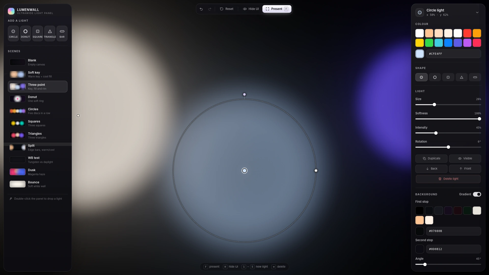
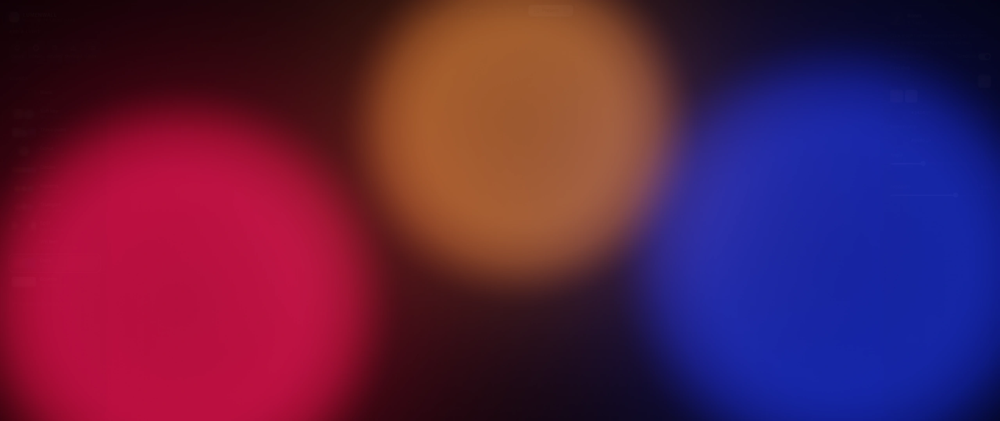
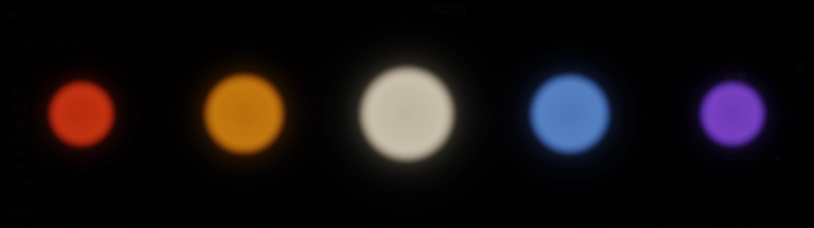
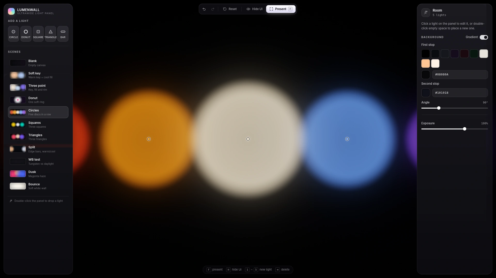
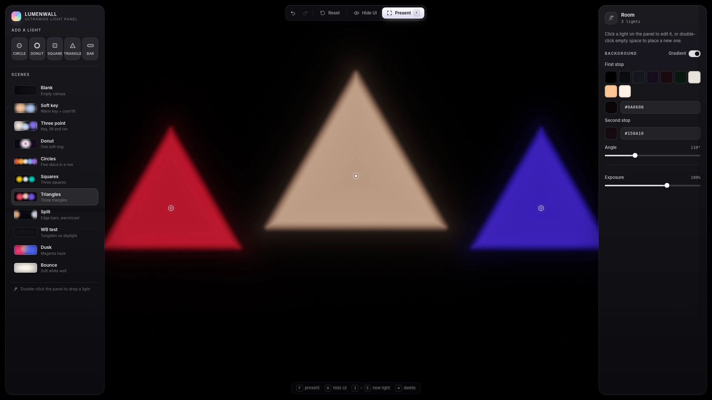

# Lumenwall

**A 49″, 32:9 display is a very large soft light. This turns it into a lighting desk.**

Place coloured lights anywhere on a full-screen panel, shape them, dim them — and film next to it.

[](https://swanlepeltier.github.io/lumenwall/)

<sub>Live demo: **https://swanlepeltier.github.io/lumenwall/** — press <kbd>F</kbd> for the full-screen light panel.</sub>

---

## Why this exists

Filming at a desk usually means fighting whatever is behind you. A 32:9 monitor is a 120 cm wide, 34 cm tall light source that already sits in exactly the right place: in front of the talent, wrapping around both cheeks. Plugging it with a web page turns a desk into a softbox, a rim light, a coloured background, or all three at once.

Most "light panel" pages are either a single flat colour or a party-mode animation. Lumenwall is built like a lighting tool: individual lights with position, shape, colour, size and softness, over a background you can grade, saved locally and recalled in one click.

It is a purely graphical tool — nothing leaves the browser, no account, no network, no analytics.

## What you can do

- **Place lights anywhere** on the panel — drag them, or double-click empty space.
- **Five shapes**: circle, donut (`ring`), square, triangle, bar. Each has its own softness, so a shape can be a crisp graphic or a fully diffuse bloom.
- **Per-light controls**: colour (with 3200 K → 6500 K presets and a hex field), size, softness, intensity, rotation, visibility, stacking order.
- **Background**: solid colour or two-stop gradient with an angle, plus a master exposure for the whole panel.
- **11 scenes** to start from — Soft key, Three point, Donut, Circles, Squares, Triangles, Split (edge bars), WB test (tungsten vs daylight), Dusk, Bounce (full-panel white fill), Blank.
- **Present mode** (`F`): true fullscreen, interface hidden, cursor hidden. Move the mouse to bring the UI back for a few seconds.
- **Undo / redo**, autosave to `localStorage`, and a keyboard-first workflow.
- **Responsive**: the same app works on a laptop, a tablet, or the 49″ panel it was written for.

## Screenshots

| The whole point (`F`) | On the target display |
| --- | --- |
|  |  |

| Circles | Triangles |
| --- | --- |
|  |  |

## Quick start

```bash
npm install
npm run dev      # http://localhost:3000
```

Production build (static export — no server needed):

```bash
npm run build    # writes ./out
npx serve out
```

The site is a static export (`output: "export"`). Set `NEXT_PUBLIC_BASE_PATH` when hosting it from a sub-path (the bundled GitHub Pages workflow does this).

## Keyboard

| Key | Action |
| --- | --- |
| <kbd>F</kbd> | Present mode / leave it |
| <kbd>H</kbd> | Hide or show the interface |
| <kbd>1</kbd> … <kbd>5</kbd> | Add a circle, donut, square, triangle or bar |
| <kbd>←↑↓→</kbd> | Nudge the selected light (<kbd>Shift</kbd> = bigger step) |
| <kbd>[</kbd> / <kbd>]</kbd> | Shrink / grow the selected light |
| <kbd>Ctrl</kbd>/<kbd>⌘</kbd> + <kbd>D</kbd> | Duplicate the selected light |
| <kbd>Del</kbd> | Delete the selected light |
| <kbd>Ctrl</kbd>/<kbd>⌘</kbd> + <kbd>Z</kbd> | Undo (<kbd>Shift</kbd> to redo) |
| <kbd>Esc</kbd> | Deselect, then leave present mode |

Mouse: drag a light to move it, <kbd>Shift</kbd>-drag to lock an axis, wheel to resize, <kbd>Alt</kbd>-drag to duplicate, drag the handles to resize or rotate.

## How it renders

Everything is drawn by one fragment shader on a full-screen quad (WebGL2, no dependency):

- Each light is a signed-distance shape — circle, ring, rounded box, equilateral triangle, bar — sampled with a feathered edge and an exponential bloom, cropped by colour, not by texture.
- Contributions are **accumulated additively in linear light**, then passed through a photographic shoulder (`1 - exp(-x)`) so overlapping lights roll off instead of clipping into flat blobs.
- Sizes are expressed as a fraction of the **screen height**, so a circle stays perfectly round whether the window is 16:9 or 32:9.
- A sub-LSB dither in the output kills the banding that large soft gradients otherwise show on a 49″ panel — and that a camera will happily pick up.
- The scene is static: it is redrawn only when something changes. No flicker, no GPU load while you record.

## Roadmap

- Curve compensation for curved 32:9 panels.
- Scene import/export as JSON, and shareable links.
- Multi-display targeting (one scene per screen).
- DMX / OSC bridge for hybrid screen + practicals setups.

Ideas and pull requests welcome.

## License

[MIT](LICENSE) © 2026 Swan Lepeltier
